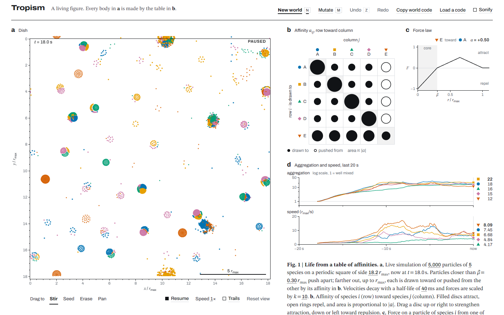
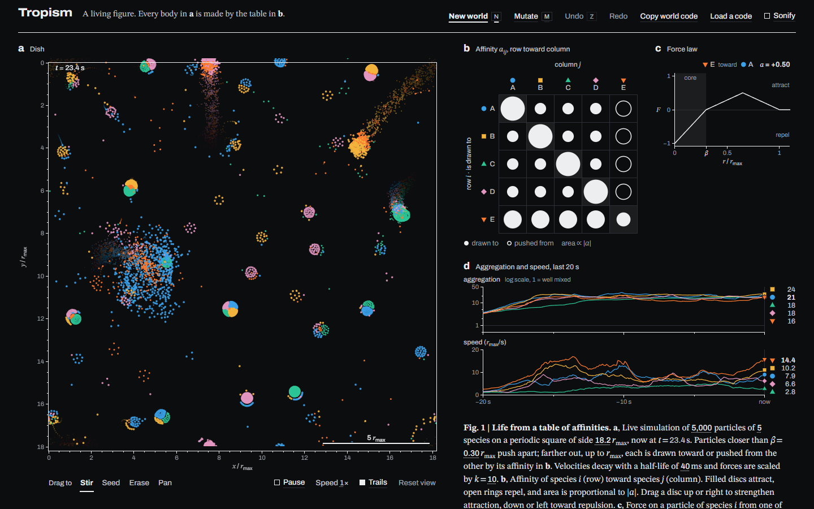
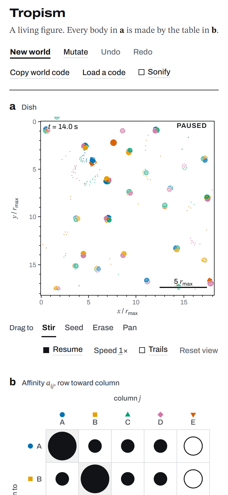

# Tropism

**A living research figure.** Thousands of particles, a handful of species, and one small table of numbers that decides who is drawn to whom. From that table alone, cells, membranes, swimmers, hunters and colonies assemble themselves on screen. Drag one number and watch a different kind of life appear.

### [▶ Play it in your browser](https://tringytrongy.github.io/tropism/)



No install, no sign-up. It runs entirely in the browser, on a laptop or a phone.

---

## What you are looking at

The page is laid out like a figure from a scientific paper, except every panel is live.

| Panel | What it shows | What you can do |
|---|---|---|
| **a** · Dish | The simulation: particles of up to eight species on a square whose edges wrap around. Axes are in units of the interaction radius, with a scale bar. | **Drag** to stir, seed new particles, erase, or pan. **Click** a particle to track it and draw its path. **Scroll** or pinch to zoom; zoom far enough and each species shows its plot marker. |
| **b** · Affinity table | How strongly each species (row) is drawn to every other species (column). Filled discs attract, open rings repel, and area is proportional to strength. | **Drag a disc** up or right to strengthen attraction, down or left toward repulsion. The dish reacts immediately. Arrow keys and +/− work too. |
| **c** · Force law | The force between the hovered pair as a function of distance. At rest it shows the most lopsided pair, which is the kind that makes chasers. | Hover or tap a disc in **b**. |
| **d** · Traces | How clumped each species is (aggregation) and how fast it moves, over the last 5 simulated seconds. | Watch the world settle, or not. |
| Caption | "Fig. 1": a written description of the experiment. | **Drag any dotted number** in it (particle count, species count, size of the square, core radius, friction, force) to change the world live. |

Along the top: **New world**, **Mutate** (nudges one to three affinities), **Undo / Redo** (every change to the law is a revision), **Copy world code**, **Load a code**, and **Sonify**, which gives each species a voice so you can hear the dish condense.

Scroll down for **Extended Data**, nine hand-picked worlds ordered from two species to eight, and **Methods**, which explains the model.

<p align="center">
  
  &nbsp;
  
</p>

## Things to try

1. Open **Hunted colonies** (the world it starts with). Species A–D clump together; everyone flees E, and E is drawn to everyone. Watch the orange hunters latch onto colonies and drive them across the dish.
2. In panel **b**, drag the bottom-right disc (E toward E) down until it becomes an open ring. The hunters stop holding together.
3. Press **N** a few times. Every new world is a random table; most of them do something.
4. Turn on **Trails**, then click a fast particle to track it.
5. Drag the **species** number in the caption from 3 up to 8 and back.
6. Found something good? **Copy world code**. On this site it copies a link that rebuilds exactly that world.

## Keyboard

| Key | Action |
|---|---|
| `Space` | Pause or resume |
| `N` | New world with the same number of species |
| `M` | Mutate one to three affinities |
| `Z` / `Shift`+`Z` | Undo / redo a revision |
| `1`–`4` | Stir, seed, erase, pan |
| `T` | Trails on or off |
| `0` | Reset the view |
| `Esc` | Stop tracking |
| Arrows, `+`, `−` | Move through panel **b** and change the focused affinity |

## How it works

Every particle of species *i* feels a force from every particle of species *j* closer than the interaction radius *r*<sub>max</sub>. With *r* measured in units of *r*<sub>max</sub>:

```math
F(r) =
\begin{cases}
r/\beta - 1 & r < \beta \\[4pt]
a_{ij}\left(1 - \dfrac{|2r - 1 - \beta|}{1 - \beta}\right) & \beta \le r < 1 \\[4pt]
0 & r \ge 1
\end{cases}
```

The first branch is a short-range repulsion shared by every pair, so particles never overlap. The second is a tent whose peak is the affinity *a*<sub>ij</sub>, the one number per pair you edit in panel **b**.

The table is **not symmetric**: *a*<sub>ij</sub> is how *i* responds to *j*, and *a*<sub>ji</sub> how *j* responds to *i*. That deliberately breaks Newton's third law, which is why the dish never settles into stillness. A species drawn to another that flees it will chase it forever.

A few rules of thumb:

- A positive diagonal entry makes a species clump; a negative one spreads it into a gas.
- *i* attracted to *j* while *j* is repelled by *i* makes chasers and travelling bodies.
- Mutual attraction makes shared bodies; mutual repulsion draws boundaries.
- Cycles (*i* chases *j*, *j* chases *k*, *k* chases *i*) make chains and rotating rings.

### Under the hood

- **Physics** (`src/sim.js`): semi-implicit integration at Δ*t* = 0.004 s with velocity damping by half-life. The page plays the dish in slow motion (a tenth of real time at 1×), so single particles are easy to follow. Neighbours come from a uniform grid of cells at least *r*<sub>max</sub> wide, so a step costs O(*N*). Each pair is visited once and both forces are applied with their own affinities. About 4–5 ms per step at 5,000 particles on a laptop.
- **Off the main thread** (`src/sim-worker.js`, `src/sim-host.js`): the simulation runs in a Web Worker and streams positions back through swapped transferable buffers, so drawing and controls stay smooth even when a dense world costs 15+ ms per step. If a Worker cannot start, the same code runs on the main thread.
- **Rendering** (`src/render.js`): WebGL2 instanced quads with a signed-distance marker per species (circle, square, triangle, diamond, …), antialiased, with ink-over-paper compositing in both themes. There is a Canvas2D fallback with the same behaviour.
- **Reproducible worlds** (`src/genome.js`): a world code like `t1.5…` stores the table, every parameter and the random seed. The same code rebuilds the same starting state, and the simulation replays identically until someone touches the dish.
- **Accessible by design**: species are told apart by marker shape as well as colour (Okabe–Ito colour-blind-safe palette). Every control works from the keyboard. Playback speed is measured against the clock, so it is the same on any display; reduced-motion settings halve it. Light and dark themes follow your system.
- **No dependencies, no build step** for development: plain ES modules, hand-written SVG plots, Web Audio for sound.

## Run it locally

You need [Node.js](https://nodejs.org/) 20 or newer (only for the local server, tests and tools; the app itself has no dependencies).

```bash
git clone https://github.com/TringyTrongy/tropism.git
cd tropism
node tools/serve.mjs
```

Then open <http://localhost:5173/>. A local server is needed because browsers block ES modules and workers on `file://`.

### Build a single file

```bash
node tools/build.mjs
```

This writes `dist/index.html` with the stylesheet, every module and the worker inlined: one self-contained file you can host anywhere. `--fragment` writes the same page without the `<html>`/`<head>`/`<body>` wrapper, for hosts that supply their own.

### Tests and tools

```bash
node --test "tests/*.test.mjs"   # 188 tests: physics, encoding, worker protocol, UI components
node tests/bench.mjs             # time a simulation step
node tools/find-presets.mjs      # re-run the search that picked the Extended Data worlds
```

`tests/*.html` are small visual test pages for single components (open them through the local server). `tools/capture.mjs` takes headless screenshots at any viewport; add `?debug=900` to the page URL to pre-run 900 simulation steps.

## Project layout

```
index.html            the page (figure, Extended Data, Methods)
styles.css            colour and type tokens, layout, light and dark themes
src/main.js           app state, revision history, dish tools, caption controls, frame loop
src/sim.js            particle-life engine (runs in Node too)
src/sim-worker.js     the simulation's Web Worker
src/sim-host.js       main-thread side of the worker, with a fallback
src/genome.js         seeded RNG, world model, mutate/randomise, world codes
src/render.js         WebGL2 dish renderer with a Canvas2D fallback
src/matrix.js         panel b: the editable bubble correlogram
src/plots.js          panel c, panel d and the dish axes (SVG)
src/scrub.js          draggable numbers in the caption
src/audio.js          optional sonification
src/markers.js        species palette and plot markers
src/presets.js        the Extended Data worlds (generated)
tools/                local server, single-file build, preset search, screenshots
tests/                Node tests, benchmark, component test pages
media/                screenshots for this README
```

## Credits

- The model belongs to the family of particle-life simulations, which began with Jeffrey Ventrella's [*Clusters*](https://ventrella.com/Clusters/) and includes CodeParade's [*Particle-Life*](https://github.com/HackerPoet/Particle-Life) (2018). The force law follows the one popularised by Tom Mohr's [*Particle Life*](https://particle-life.com/), explained in his [video](https://youtu.be/scvuli-zcRc).
- Species colours follow Masataka Okabe and Kei Ito's colour-blind-safe palette.
- Type: [Archivo](https://fonts.google.com/specimen/Archivo) and [STIX Two Text](https://fonts.google.com/specimen/STIX+Two+Text), via Google Fonts.
- The Extended Data worlds were found by a seeded search and named by hand. They are illustrations, not observations of real organisms.

## License

[CC BY-NC-SA 4.0](LICENSE). You may share and adapt Tropism for **non-commercial** purposes, as long as you credit it and release your adaptation under the same license. Commercial use, including selling it or building it into a paid or closed-source product, is not permitted without permission; open an issue to ask.
